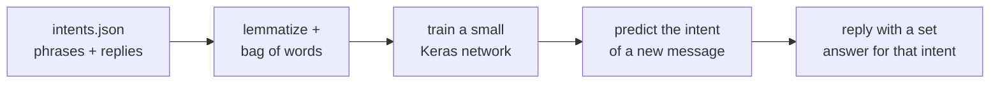

<div align="center">

# 🤖 Persian Intent Chatbot

**A chatbot that sorts your message into an intent and replies with a set answer. English, and Persian with `hazm`. No text generation, so it can only say what I wrote.**

</div>

---

> [!NOTE]
> This started as a course exercise. The code is cleaned up and the data, the intents and this write up are my own.

## The idea

A lot of chatbots invent text and sometimes invent facts with it. This one does not generate anything. It reads my list of example phrases, learns which intent a new sentence belongs to, and replies with one of the answers I wrote for that intent. The output is predictable on purpose.

## How it works



Because every reply comes from a fixed list, the bot cannot make something up. That constraint is the whole point.

## The files

| File | What it is |
| --- | --- |
| `intents.json` | The intents: example phrases and the set replies for each |
| `train_chatbot.ipynb` | Builds the bag of words and trains the model |
| `run_chatbot.ipynb` | Loads the model and runs the chat loop |
| `persian_nlp_hazm.ipynb` | Persian text cleaning and tokenizing with `hazm` |

## Run it

```bash
python -m venv .venv
source .venv/bin/activate
pip install tensorflow keras nltk hazm numpy
```

Run `train_chatbot.ipynb` once to build the model. It is gitignored, so it is not in this repo and you regenerate it. Then run `run_chatbot.ipynb` to chat.

> [!WARNING]
> It only knows the intents I gave it. Ask something outside that list and it will still pick the closest intent, which can be wrong. It is a small teaching project, not a general assistant.
