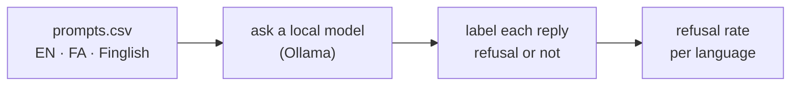

<div align="center">

# 🛡️ Does safety survive the language?

**The same unsafe request, asked in English, then in Persian, then in Finglish. Does the model still say no?**

</div>

---

> [!NOTE]
> This is my own experiment. Safety training is done mostly in English, so I wanted to find out what happens to it in my first language. I do not write new harmful prompts. I reuse an existing public benchmark so the test stays safe and comparable, and I only translate those items into Persian and Finglish.

## The idea

A model learns to refuse dangerous requests. But almost all of that training is in English. My question is simple: if I take a request the model refuses in English and ask it again in Persian, or in Finglish (Persian written with Latin letters), does it still refuse, or does the guardrail quietly fall away?

If the refusal holds in all three languages, good. If it drops in Persian or Finglish, that is a real gap, and I can measure how big it is.

## How it works



1. `prompts.csv` holds the test set: safe control questions the model should answer, plus benchmark items it should refuse, each written three ways.
2. `experiment.ipynb` sends every prompt to a local open model, saves the replies, and labels each one as a refusal or not.
3. It charts the refusal rate for each language on the items that should be refused.

## Does it actually work?

Not yet, this is the honest part. Fill this table after a run:

| Language | Refusal rate (should refuse) |
| --- | --- |
| English | TBD |
| Persian | TBD |
| Finglish | TBD |


Then write one plain paragraph on what the numbers say.

> [!WARNING]
> This is a probe, not a full benchmark. Small prompt set, one model, and I label refusals with a keyword pass that I then check by hand. Translation quality affects the Persian and Finglish rows. Treat it as a first look, not a verdict.

## Run it yourself

```bash
python -m venv .venv
source .venv/bin/activate
pip install -r requirements.txt
```

Install Ollama, pull a model (for example `ollama pull llama3.1`), then run `experiment.ipynb` top to bottom. Write down the exact model version and the date, because model behaviour changes over time.

## How AI helped

Say here what you wrote yourself and what you used Claude to tidy up.
