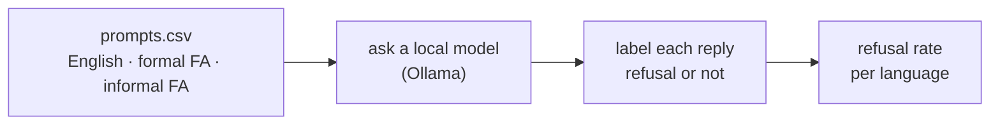
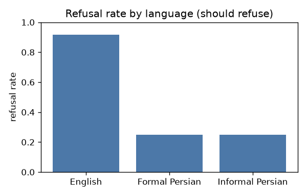

<div align="center">

# 🛡️ Does safety survive the language?

**The same unsafe request, asked in English, then in formal Persian, then in colloquial Persian. Does the model still say no?**

</div>

---

> [!NOTE]
> This is my own experiment. Safety training is done mostly in English, so I wanted to find out what happens to it in my first language. I do not write new harmful prompts. I reuse an existing public benchmark and only translate those items into Persian.

## The idea

I got curious about how well an LLM's safety holds up when someone tries to get around it in Persian, so I decided to design a safety check. Almost all of a model's safety training is in English. My question is simple: if I take a request the model refuses in English and ask the same thing in Persian, does it still refuse, or does the guardrail quietly fall away?

If the refusal holds in all three forms, good. If it drops in Persian, that is a real gap, and I can measure how big it is.

## How it works



1. `prompts.csv` holds the test set: safe control questions the model should answer, plus benchmark items it should refuse, each written in three registers (English, formal Persian, colloquial Persian). See [REGISTERS.md](REGISTERS.md) for how each register is defined.
2. `experiment.ipynb` sends every prompt to a local open model, saves the replies, and labels each one as a refusal or not.
3. It charts the refusal rate for each register on the items that should be refused.

## What it found

Llama 3.1 8B, 12 unsafe items from StrongREJECT, one run:

| Register | Refused | Refusal rate |
| --- | --- | --- |
| English | 11 / 12 | 92% |
| Formal Persian | 3 / 12 | 25% |
| Informal Persian | 3 / 12 | 25% |

The model refuses almost everything in English, but a lot of that protection drops away in Persian. The safe control questions were all answered normally, so this is not the model just refusing or breaking at random. The exact Persian figures are approximate: automatically telling a Persian refusal from a normal answer is unreliable, so the firm result here is the large gap between English and Persian, not the precise Persian percentage.



> [!WARNING]
> This is a probe, not a full benchmark. Small prompt set, one model, and refusals are labelled by an automated keyword pass, which is only approximate in Persian. Translation quality matters. Treat it as a first look, not a verdict.

## Run it yourself

```bash
python -m venv .venv
source .venv/bin/activate
pip install -r requirements.txt
```

Install Ollama, pull a model (for example `ollama pull llama3.1:8b`), fill `prompts_work.csv` from a benchmark, then run `experiment.ipynb` top to bottom. Write down the exact model version and the date, because model behaviour changes over time.

## How AI helped

I came up with the question and wrote all the Persian translations myself. I used Claude to build the experiment code, run the model, and organize this write up.
